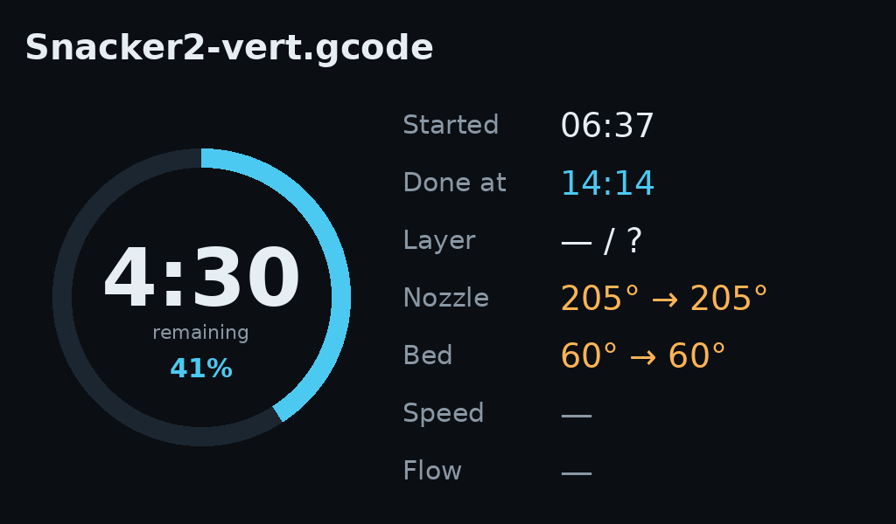
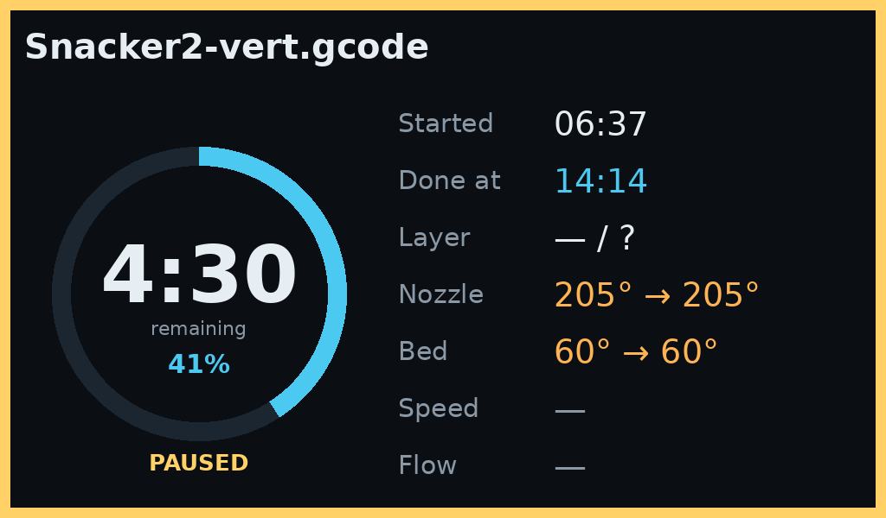

# octopi_screen

An OctoPrint status dashboard for a cheap 1024×600 USB LCD, running on the same Raspberry Pi as OctoPi. You can read it from across the room: time remaining, finish time, layer, temperatures, and speed and flow. You don't need to open a browser.



The screen only displays status. It never controls the printer.

## What it shows

- **Top bar:** the file name. Long names shrink, then are shortened in the middle.
- **Ring:** time remaining and the percentage complete.
- **Started** and **Done at**, in 24-hour local time. If the print finishes on a later day, `+1d` is added.
- **Layer:** the current layer and the total, read from the G-code's layer comments. `?` means the total is unknown.
- **Nozzle** and **Bed:** the actual and target temperatures.
- **Speed** and **Flow:** Marlin's feed-rate and flow percentages, read with `M220` and `M221`.

Until OctoPrint has its own estimate, the dashboard uses the slicer's build-time estimate from the G-code and marks the value `est.`. After that it follows OctoPrint's estimate.

The border shows when something needs attention:

| Border | Meaning |
|---|---|
| none | Printing or idle |
| yellow | Paused |
| blinking red for 5 minutes, then solid red | The print failed or was cancelled. It stays red until the next print starts. |
| grey | OctoPrint or the printer is offline |



When nothing is printing, the screen keeps showing the last print and how it ended. A failure stays visible after a reboot.

## Hardware

### The LCD

This was bought on AliExpress: <https://www.aliexpress.com/item/1005009570496543.html>

It is a USB-only display: one USB cable carries both power and video, and there is no HDMI. These values were reported by the panel itself:

| Property | Value |
|---|---|
| USB ID | `345f:9132` (`USB Display` / `usb extscreen`) |
| Controller | MacroSilicon MS912x family |
| USB | 2.0, bus powered, draws 500 mA |
| Native mode | 1024×600 at 60 Hz (EDID monitor name `USBDISPLAY`) |
| Other modes | 800×600 |

The controller has no driver in the mainline Linux kernel. Under Linux it needs the out-of-tree [`ms912x`](https://github.com/rhgndf/ms912x) DRM driver. With that driver loaded, the panel appears as a DRM device and as a framebuffer at `/dev/fb0`. Sellers list several near-identical panels. Check `lsusb` for `345f:9132` or another ID that the driver supports.

### Tested setup

- Raspberry Pi 4 (1 GB) running OctoPi on Raspberry Pi OS Bookworm, 32-bit, kernel `6.6.51+rpt-rpi-v7l`
- OctoPrint 1.11.8
- Marlin 2.1 printer firmware (Ender 3)
- G-code from Simplify3D. The layer count comes from its `; layer N, Z = …` comments. Files from other slicers show `?` for the total.

## The LCD driver

The upstream driver works, but on this panel it had two problems. Both are fixed by the patches in [`driver/patches/`](driver/patches/), which apply to the `kernel-6.6` branch of rhgndf/ms912x at commit `061ba0c`.

**The screen goes black 3–5 seconds after the image stops changing.** The controller turns its video output off (the panel's LED goes from green to red) when no frame data arrives over USB for a few seconds. A static dashboard therefore went dark almost immediately. Patches 1 and 3 add a keepalive that resends a 2×1-pixel rectangle every second while the screen is idle. That is about 20 bytes per second.

**After a display power-off (DPMS) the USB endpoint sometimes jams.** The controller accepts the first 1 KB of a frame and then refuses everything after it, so the screen stays frozen. Patch 5 waits 300 ms after powering off before it accepts a power-on, which makes the jam much rarer (from 4 in 10 cycles to 1 in 19 in testing). If a transfer still times out, the patch recovers by forcing a full mode set.

The other patches add:

- a read-only debugfs file for the output timing registers (patch 2)
- quieter logging: per-transfer messages are moved to DRM debug (patch 4)
- a `dkms.conf` that builds for the kernel being installed rather than the running one, so the driver survives kernel upgrades (patch 6)

### Installing the driver

On the Pi:

```sh
sudo apt install dkms git linux-headers-rpi-v7l
git clone -b kernel-6.6 https://github.com/rhgndf/ms912x.git
cd ms912x
git checkout 061ba0c
git am /path/to/octopi_screen/driver/patches/*.patch
sudo cp -r . /usr/src/ms912x-1.1
sudo dkms install ms912x/1.1
sudo modprobe ms912x
```

`linux-headers-rpi-v7l` is the header package for a Pi 4 running 32-bit Bookworm. On another setup, install the headers that match `uname -r`, for example `linux-headers-rpi-v8` on 64-bit. Avoid the old `raspberrypi-kernel-headers` package: it does not match the 6.6 kernels.

The patches add three module parameters, which can be changed at runtime under `/sys/module/ms912x/parameters/`:

| Parameter | Default | Meaning |
|---|---|---|
| `keepalive_ms` | `1000` | Keepalive interval while the screen is static. `0` turns it off. |
| `power_off_delay_ms` | `300` | Minimum time between DPMS off and the next power-on |
| `recover_on_timeout` | `Y` | Force a mode set when a frame transfer times out |

## Installing the dashboard

The dashboard is a small Python program. It runs under systemd as the normal `octopi` user, alongside OctoPrint.

Requirements on the Pi are Python 3.11 with Pillow and requests, both already present on OctoPi, plus `websocket-client`, which the deploy script installs into a virtualenv.

From a development machine that can SSH to the Pi:

```sh
export PI_SCREEN_HOST=octopi@octopi.local   # the default; set this to your Pi
ssh "$PI_SCREEN_HOST" sudo -v               # first install only
deploy/deploy.sh --install                  # first install
deploy/deploy.sh                            # later updates: sync code, restart
```

`--install` copies the code to `~/pi-screen`, creates `.venv` there, and installs two root-owned files:

- `/etc/systemd/system/pi-screen.service`
- `/usr/local/sbin/pi-screen-console`, a helper that detaches the text console from the LCD while the dashboard runs and reattaches it when the dashboard stops

Only that helper runs as root. The dashboard process itself does not.

It reads OctoPrint's API key from `~/.octoprint/config.yaml`, so no extra configuration is needed on a standard OctoPi.

### Options

`python -m pi_screen.app` accepts:

| Flag | Default |
|---|---|
| `--octoprint` | `http://127.0.0.1:5000` |
| `--config` | `~/.octoprint/config.yaml` (source of the API key) |
| `--state` | `~/.local/state/pi-screen/last-print.json` |
| `--uploads` | `~/.octoprint/uploads` (G-code is read here to count layers) |
| `--fb` | `/dev/fb0` |
| `--fixture NAME` | Draw `tests/fixtures/job_NAME.json` instead of polling OctoPrint |
| `--png FILE` | Render one frame to a PNG and exit |

## How it works

- Polls OctoPrint's REST API every 2 seconds, and follows OctoPrint's push socket to get print events and the printer's replies.
- Every 15 seconds while the printer is connected, it sends `M220` and `M221` to read speed and flow. It sends no other G-code.
- Draws with Pillow into `/dev/fb0` through `mmap`, and only redraws regions that changed. The driver converts every changed pixel on the CPU, so small updates matter on a Pi that is also running a print. Plain `write()` calls to the framebuffer do not reach the panel with this driver, which is why it uses `mmap`.
- Skips rendering when nothing visible has changed. When idle it uses about 3% of one core and about 35 MB of memory.
- If the LCD is unplugged, the process exits with status 3. systemd retries every 5 seconds and redraws the whole screen when the LCD returns.

## Operating

```sh
systemctl status pi-screen
journalctl -u pi-screen -f
sudo systemctl disable --now pi-screen    # stop and give the LCD back to the console
```

While the dashboard runs it keeps `/dev/fb0` open, so `rmmod ms912x` fails with "Module ms912x is in use". Stop the service before reloading or updating the driver, and start it again afterwards.

## Development

```sh
uv venv --python 3.11 .venv
uv pip install --python .venv/bin/python pillow==9.4.0 requests==2.28.1 websocket-client==1.8.0 pytest==8.3.5
.venv/bin/pytest
.venv/bin/python -m pi_screen.app --fixture printing --png /tmp/printing.png
```

These versions match what is installed on OctoPi Bookworm. The fixtures in `tests/fixtures/` are `printing`, `paused` and `idle`.

The design notes and implementation plan are in [`docs/superpowers/`](docs/superpowers/).

## Licences

- The driver patches modify GPL-2.0 code and are released under GPL-2.0.
- The bundled DejaVu fonts are under the licence in [`pi_screen/fonts/LICENSE-DejaVu`](pi_screen/fonts/LICENSE-DejaVu).
